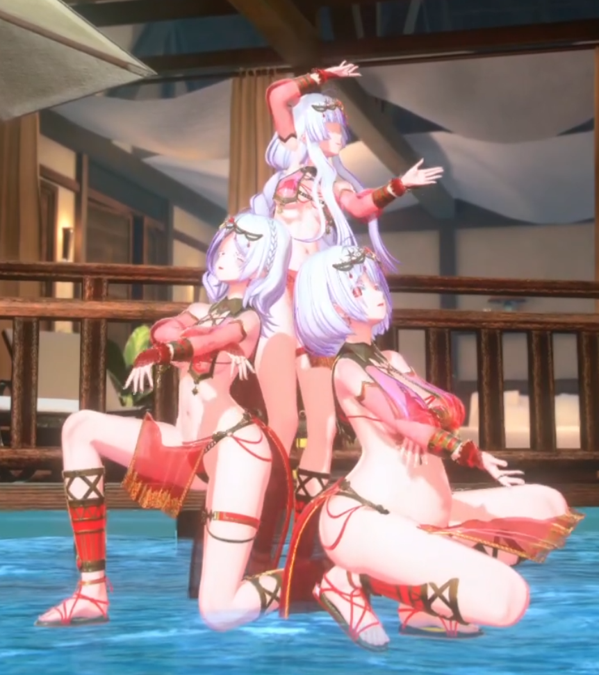

# AL MMD

Plays MikuMikuDance motion files in AmanatsuLocation. Requires BepInEx 6 IL2CPP.
AL Heels is optional and provides heel support.

Extract the release ZIP into the game folder. Put each song in its own folder under
`BepInEx/plugins/AL_MMD/Songs` with `music.wav` and `motion.vmd`. Add `camera.vmd`
for a recorded camera or turn on the free camera in the song menu. Press **D**
to open the menu or stop playback. **G** cycles gaze modes.

For separate performer motions, use `dancers/<part>/motion.vmd` inside the song
folder. The free camera uses right-drag to orbit, middle-drag to pan, and the wheel
to zoom.

The [example layouts](examples/Songs) use empty placeholder files for single and
multiple performers. Replace the placeholders with your own files before copying
a song folder into the plugin's library.

Build with `dotnet build src/AL_MMD.csproj -c Release -p:GameDir=<game directory>`.
